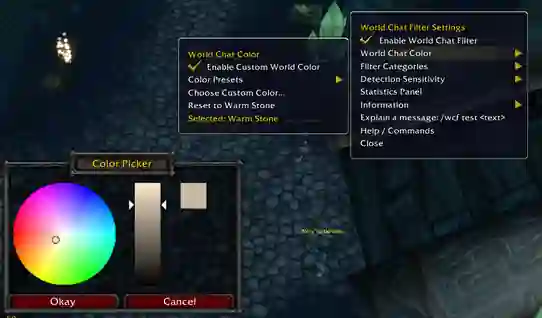
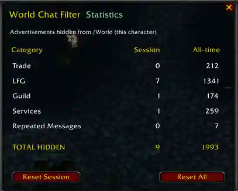
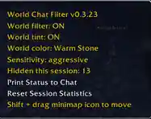
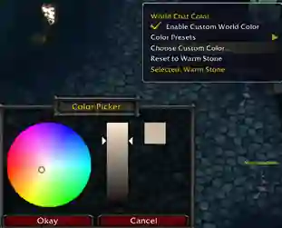
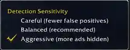
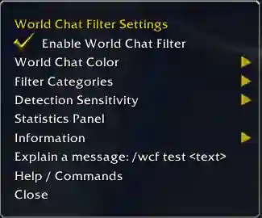

# World Chat Filter — In-game screenshots

Real screenshots captured in the **OctoWoW 1.18 client**. These images illustrate the World Chat Filter user interface. The live values shown in statistics and status are examples from one character's session, not fixed results.

## World Chat Color settings and custom color picker

The compact Blizzard-style settings menu contains filter categories, detection sensitivity, statistics and World Chat Color. The native color picker lets players adjust the World channel tint while leaving Trade and other channels unaffected.

## Statistics panel

A session and all-time breakdown of messages hidden from the **World** channel: Trade advertisements, LFG, guild recruitment, services and repeats. The counters are per character; reset buttons allow a session or full reset.

## Information menu

Quick access to filtering status, active sensitivity, selected World tint, session hidden count, and the **Shift + drag** minimap-button movement instruction.

## Custom World Chat Color picker

Use the four color presets or select a custom RGB tint using WoW's built-in Color Picker. **Dusty Gold** is the default preset; the displayed color affects only new World messages.

## Detection sensitivity

Three selectable modes: **Careful** minimizes false positives, **Balanced** is recommended for most players, and **Aggressive** attempts to hide more advertising.

## Minimap and basic settings

Additional screenshots of the circular minimap icon and the default settings menu are already available below:

---

*The screenshots are examples of the in-game UI; message filtering is client-side and limited to the World channel. Images have been compressed for repository size.*
